# **Book Store**
Bookstore Management System - A Comprehensive Solution for Cataloging, Sales, and Customer Management  
Database Project By Toiby Glazer 326484524 | Semester B, Spring 2025 
## Table of Contents
- [Part One: Design and Build the Database](#part-one-design-and-build-the-database)
  - [Introduction](#introduction)
  - [ERD (Entity-Relationship Diagram)](#erd-entity-relationship-diagram)
  - [DSD (Data Structure Diagram)](#dsd-data-structure-diagram)
  - [SQL Scripts](#sql-scripts)
  - [Data](#data)
  - [Screenshots of the Dataset](#screenshots-of-the-dataset)
  - [Backup](#backup)
- [Part Two: Queries and Constraints](#part-two-queries-and-constraints)  
  - [Queries](#queries)  
    - [Select Queries](#select-queries) 
    - [Delete Queries](#delete-queries)  
    - [Update Queries](#update-queries)  
  - [Constraints](#constraints)  
  - [Rollback and Commit](#rollback-and-commit)  
  - [Backup Part-Two](#backup-part-two) 
- [Part Three: Integration and Views](#part-three-integration-and-views)
  - [Library Department ERD & DSD](#library-department-erd--dsd)
  - [Post-Integration ERD & DSD](#post-integration-erd--dsd)
  - [Integration Process and Decisions](#integration-process-and-decisions)
  - [Views](#views)
  - [Queries](#queries)
  - [Backup Part-Three](#backup-part-three)

## Part One: Design and Build the Database
### Introduction
The **Bookstore Management System Database** is designed to efficiently manage information related to books, customers, librarians, authors, and sales transactions. This comprehensive system ensures smooth organization and tracking of essential details such as inventory management, customer memberships, book categorization, and sales history.

#### Purpose of the Database

This database serves as a structured and reliable solution for bookstores to:

- Organize and track book inventory including titles, authors, genres, languages, and shelf locations
- Manage customer information, including membership status and discount eligibility
- Record and process book orders and sales transactions
- Track librarian/staff information including experience, salary, and responsibilities
- Maintain detailed book metadata such as publication years, prices, and available languages
- Monitor book availability and stock levels across different categories and languages

 #### **Potential Use Cases**  
  - **Bookstore Managers and Administrators**
    - Track inventory levels and identify bestselling or understocked items
    - Monitor sales performance and revenue generation
    - Manage staff assignments and evaluate employee performance
    - Generate reports on sales trends, customer preferences, and inventory status
    - Make informed decisions about book ordering and promotional strategies

  - **Librarians and Sales Staff**
    - Process customer orders efficiently with access to complete book information
    - Quickly locate books on shelves using the shelf location system
    - Identify membership status and applicable discounts for customers
    - Access author and genre information to assist customers with recommendations
    - Track order history for customer service inquiries

  - **Customers**
    - Browse available books by genre, author, or language
    - Check book availability and pricing information
    - Track order history and purchase records
    - Utilize membership benefits and discounts
    - Receive personalized book recommendations based on purchase history

  - **Publishers and Authors**
    - Track book performance and sales metrics
    - Identify popular genres and language preferences
    - Analyze market trends to inform future publishing decisions

 #### Database Structure

The database is organized into several logical sections, each consisting of related tables:

#### Database Structure

- **Person Management**
  - Person: Core personal information (name, contact details, birth date)
  - Customer: Membership details and discount eligibility
  - Librarian: Staff information including experience, salary, and work history

- **Book Metadata**
  - Author: Information about book authors
  - GenreTypes: Categories of books with age recommendations
  - BookLanguage: Languages available for books

- **Inventory Management**
  - BookList: Comprehensive book information including title, price, and stock levels
  - ShelfLocation: Physical location tracking for efficient retrieval
  - Language: Tracks which books are available in which languages

- **Sales and Orders**
  - Order_Table: Transaction records including dates, prices, and involved parties
  - BookToOrder: Detailed order contents linking books to specific orders  

This structured database helps streamline bookstore operations, improving inventory management, customer service, and business intelligence capabilities. The system provides a comprehensive solution for modern bookstores seeking to optimize their operations and enhance the customer experience.
### ERD (Entity-Relationship Diagram)
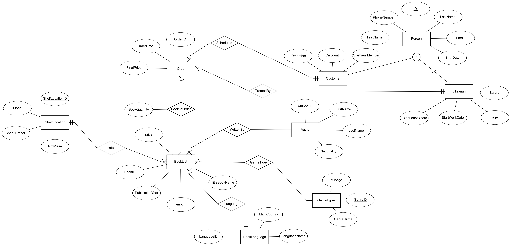
### DSD (Data Structure Diagram)
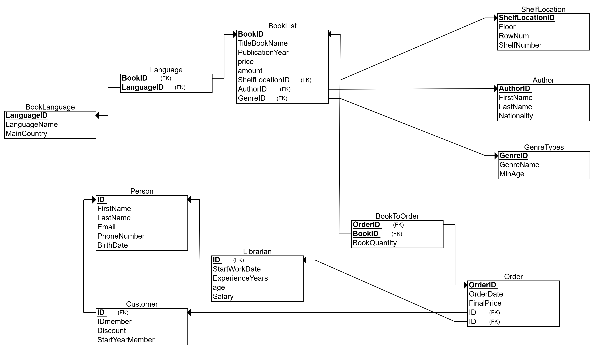
### SQL Scripts

- [Create Tables Script](Part_One/SQL_Script_Files/create_tables.sql)  Creates the database tables.
- [Insert Data Script](Part_One/SQL_Script_Files/insert_tables.sql)  Inserts initial data into the tables.
- [Drop Tables Script](Part_One/SQL_Script_Files/drop_tables.sql)  Deletes the tables from the database.
- [Select All Tables Script](Part_One/SQL_Script_Files/selectAll_tables.sql)  Retrieves all data from the tables.
### Data

#### **First tool** using [Mockaroo](https://mockaroo.com/) to create CSV files.

  - Inserting data into the **Author** (Scope: 1 - 400) table [View Author.csv](Part_One/Mockaroo/Author.csv)

  - Inserting data into the **Person** (Scope 1 - 800) table [View Person.csv](Part_One/Mockaroo/Person.csv) 
#### **Second tool** using [generatedata.com](https://generatedata.com/) to create CSV files.

  - Inserting data into the **ShelfLocation** (Scope 1 - 400) table [View Author.csv](Part_One/GenerateData/ShelfLocation.csv) 
#### **Third tool** using Python to create CSV files.
I developed a Python script that automatically generates CSV files with predefined values and constraints. The script streamlines the process by creating structured data based on specific criteria, making it easier to manage and analyze large datasets.
  - Inserting data into the **GenreTypes** (Scope 1 - 50) table [View GenreTypes.csv](Part_One/PythonScripts/GenreTypes/GenreTypes.csv) 
    **Code view**  [View GenreTypes.py](Part_One/PythonScripts/GenreTypes/CreateGenreTypes.py)

  - Inserting data into the **BookLanguage** (Scope 1 - 60) table [View BookLanguage.csv](Part_One/PythonScripts/BookLanguage/BookLanguage.csv) 
    **Code view**  [View BookLanguage.py](Part_One/PythonScripts/BookLanguage/CreateBookLanguage.py)

  - Inserting data into the **Customer** (Scope 1 - 400) table [View Customer.csv](Part_One/PythonScripts/Customer/Customer.csv) **Code view**  [View Customer.py](Part_One/PythonScripts/Customer/CreateCustomer.py)

  - Inserting data into the **Librarian** (Scope 1 - 400) table [View Librarian.csv](Part_One/PythonScripts/Librarian/Librarian.csv) **Code view**  [View Librarian.py](Part_One/PythonScripts/Librarian/CreateLibrarian.py)

  - Inserting data into the **BookList** (Scope 1 - 400) table [View BookList.csv](Part_One/PythonScripts/BookList/BookList.csv)  **Code view**  [View BookList.py](Part_One/PythonScripts/BookList/CreateBookList.py)

  - Inserting data into the **Language** (Scope 1 - 800) table [View Language.csv](Part_One/PythonScripts/Language/Language.csv)  **Code view**  [View Language.py](Part_One/PythonScripts/Language/CreateLanguage.py)

  - Inserting data into the **Orders** (Scope 1 - 800) table [View Orders.csv](Part_One/PythonScripts/Orders/Orders.csv)   **Code view**  [View Orders.py](Part_One/PythonScripts/Orders/CreateOrders.py)

  - Inserting data into the **BookToOrder** (Scope 1 - 900) table [View BookToOrder.csv](Part_One/PythonScripts/BookToOrder/BookToOrder.csv)   **Code view**  [View BookToOrder.py](Part_One/PythonScripts/BookToOrder/CreateBookToOrder.py)
### Screenshots of the Dataset

Below are the screenshots of the data for **Author**, **Person**, and **ShelfLocation** tables that I uploaded to the project. I created the values using the **GenerateData** and **Mockaroo** tools. For all the other tables, I created values using Python code.

**Author Table**:  

  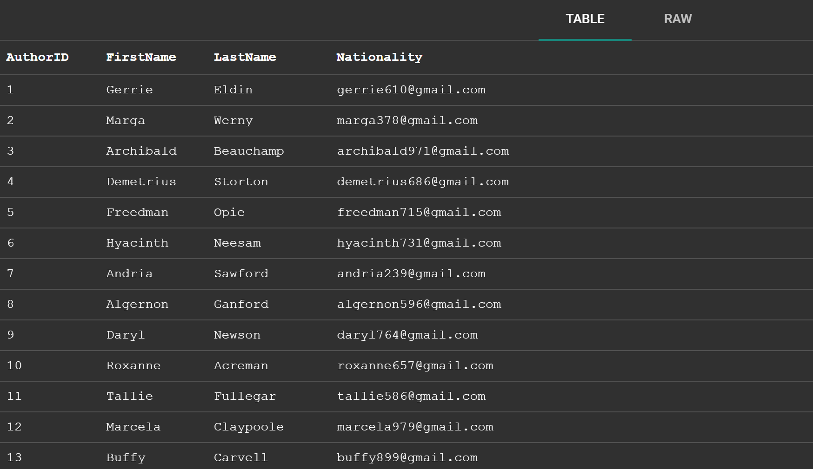
  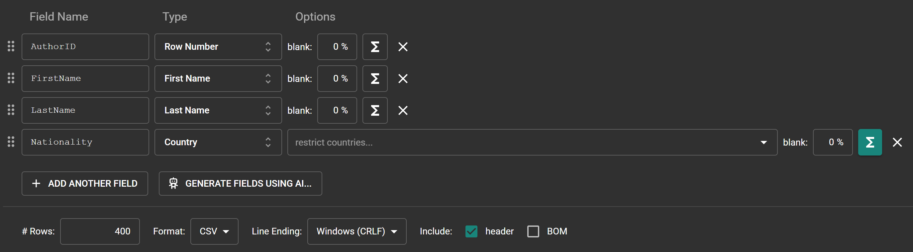

**Person Table**:  

  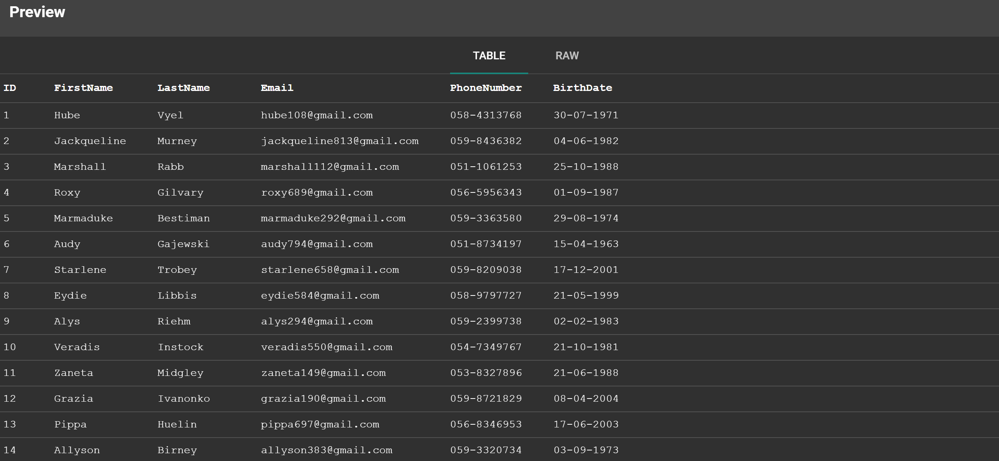
  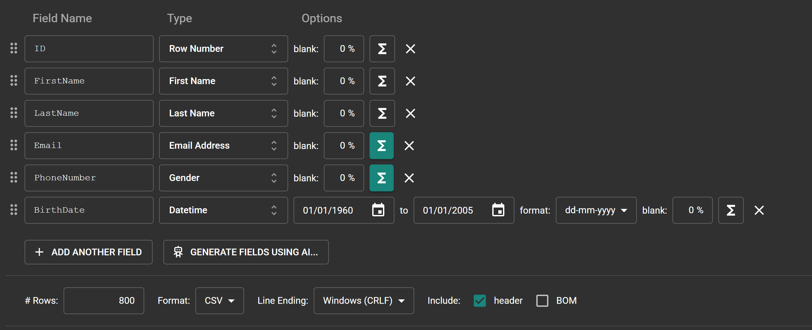
  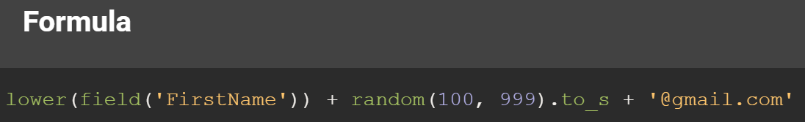
  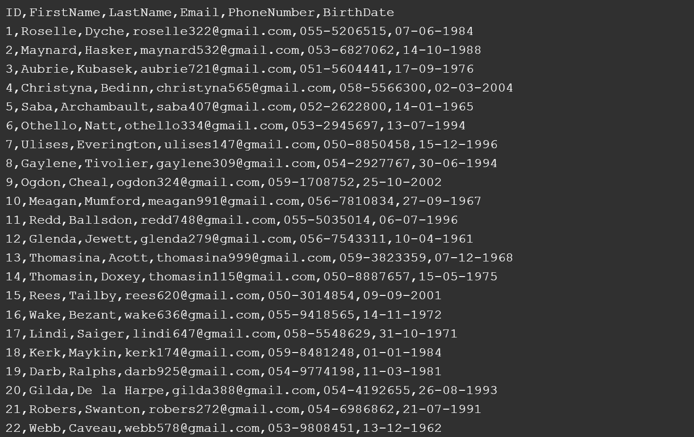

**ShelfLocation Table**:  

  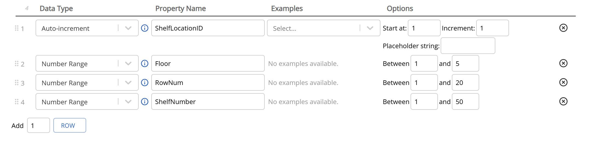
  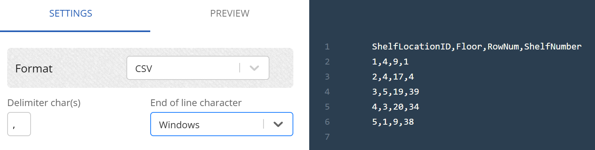

### Backup
**Data backup file** [View BackupFile.backup](Part_One/Backup/backup_2025_04_29.backup)  

**Recovery Test** To check that the data backup file indeed contains all the required tables and files that were in the original database, I created a new database **Restore Database** to check that everything was indeed backed up and restored as required.

  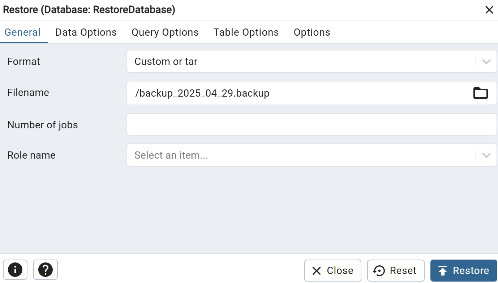
  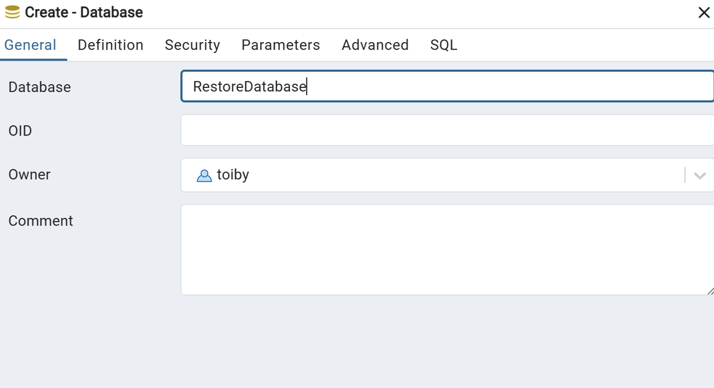
   

  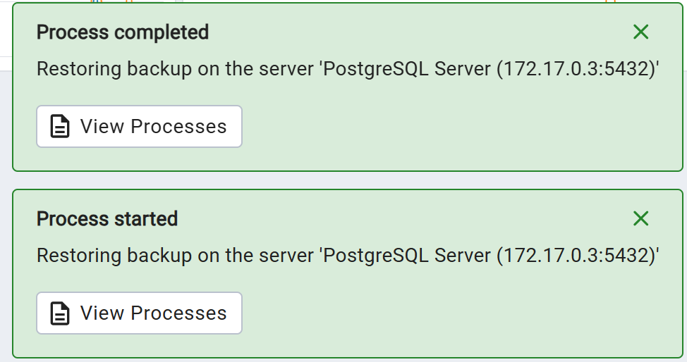
   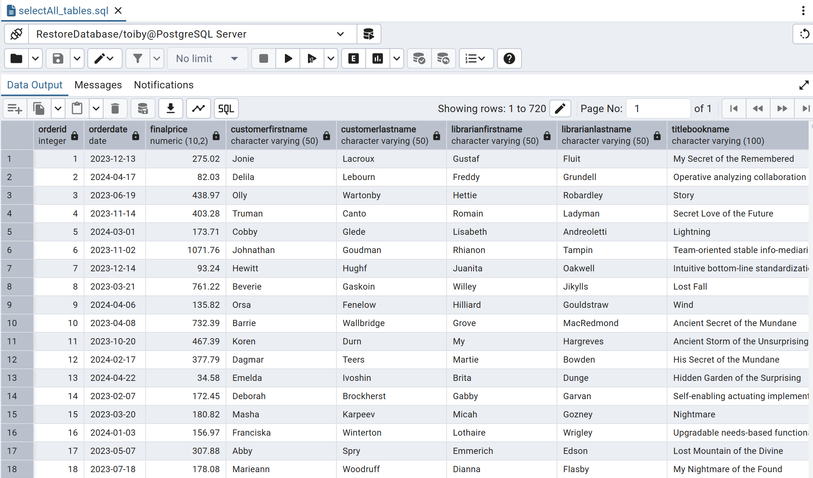

## Part Two: Queries and Constraints

**Overview** In this part, we explore and implement fundamental SQL operations essential for bookstore database management. Through practical examples of queries, constraints, and transactions, we demonstrate how to effectively retrieve business insights, maintain data integrity, and safely modify database content to support day-to-day bookstore operations.
### Queries

The queries section demonstrates the practical application of SQL to extract meaningful information from our database, modify data, and maintain database integrity. These operations are essential for day-to-day bookstore management and business intelligence.

### Select Queries

This section contains SELECT queries that retrieve specific information from the database to support various business needs and decision-making processes.

**1. Select Author Books** [View SQL](Part_Two/Queries/selectQueries/TheQueries_SQL/select_author_books.sql)
   
This query retrieves all books written by a specific author, providing a comprehensive view of an author's work available in the store.
   

  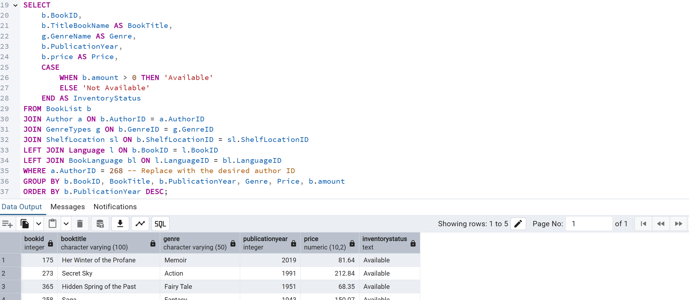

  

**2. Select Customer Order History** [View SQL](Part_Two/Queries/selectQueries/TheQueries_SQL/select_customer_order_history.sql)
   
This query retrieves a customer's complete order history, supporting customer service and personalized marketing efforts.
   

  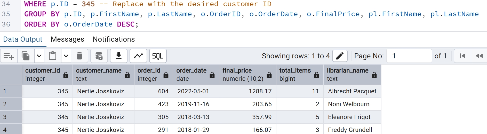

  

**3. Select Books by Genre** [View SQL](Part_Two/Queries/selectQueries/TheQueries_SQL/select_books_by_genre.sql)
   
This query lists books by genre sorted by popularity (from most to least popular), facilitating genre-based browsing and helping customers find trending books within their preferred genres.
   

  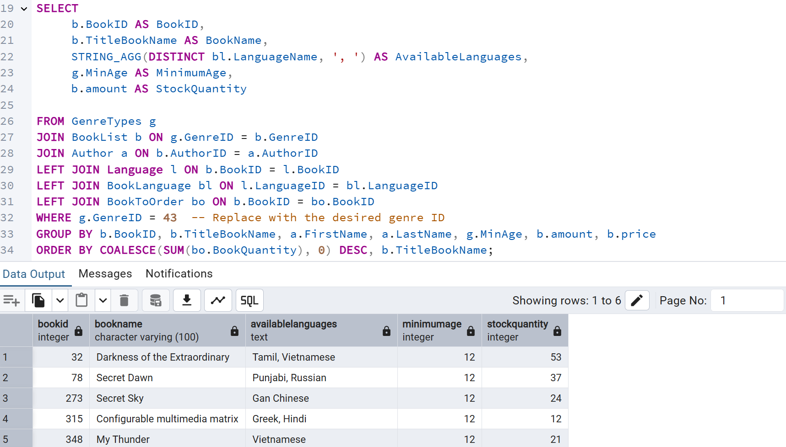

  
 
**4. Select Books by Language** [View SQL](Part_Two/Queries/selectQueries/TheQueries_SQL/select_books_by_language.sql)
   
This query identifies books available in specific languages, supporting multilingual customer needs and inventory diversity tracking.
   

  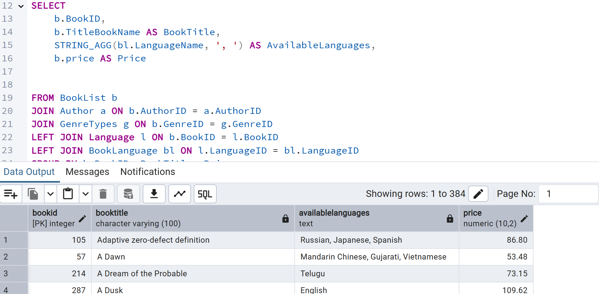

   

**5. Select Books by Location** [View SQL](Part_Two/Queries/selectQueries/TheQueries_SQL/select_books_by_location.sql)
   
This query finds books based on their physical location in the store, aiding staff in quickly locating items for customers.
   

  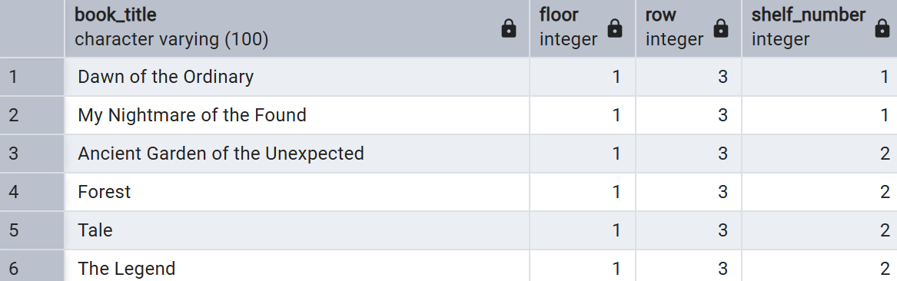

  

**6. Select Books by Age Group** [View SQL](Part_Two/Queries/selectQueries/TheQueries_SQL/select_books_by_age_group.sql)
   
This query identifies the top 3 most popular books for each customer age group (under 18, 18-30, 31-50, over 50), enabling targeted marketing strategies and inventory decisions based on age-specific reading preferences.   

  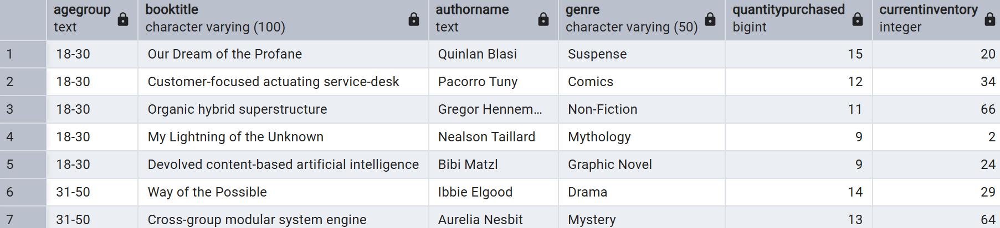

  

**7. Select Low Stock Books** [View SQL](Part_Two/Queries/selectQueries/TheQueries_SQL/select_low_stock_books.sql)
   
This query identifies books with low inventory levels, helping prevent stockouts and maintain optimal inventory levels.
   

  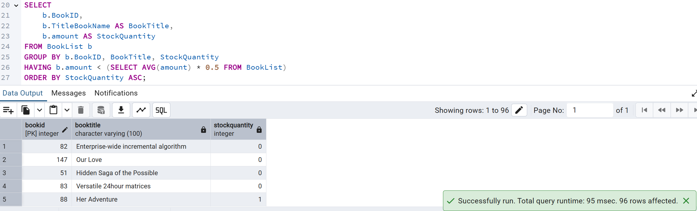

  

**8. Select Monthly Sales Statistics** [View SQL](Part_Two/Queries/selectQueries/TheQueries_SQL/select_monthly_sales_stats.sql)
   
This query analyzes sales performance by month, providing valuable insights for seasonal planning and performance evaluation.
   

  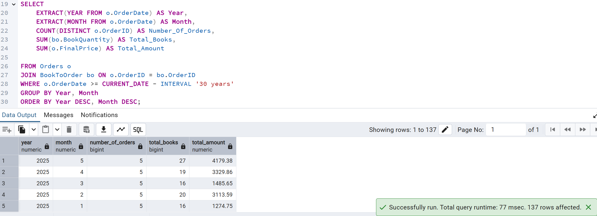

  

**9. Select Popular Books** [View SQL](Part_Two/Queries/selectQueries/TheQueries_SQL/select_popular_books.sql)
   
This query identifies the most frequently purchased books, informing restocking decisions and promotional strategies.
   

  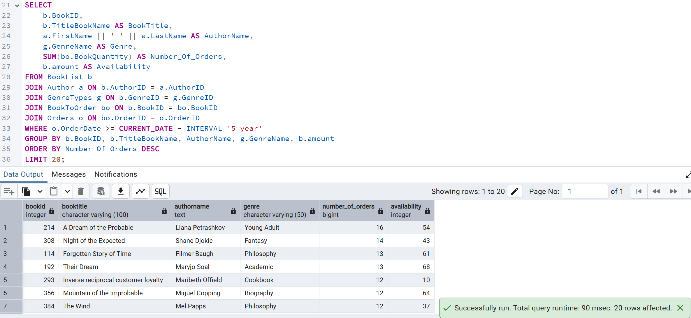

  

**10. Select Top Club Members** [View SQL](Part_Two/Queries/selectQueries/TheQueries_SQL/select_top_club_members.sql)
   
This query identifies the most active club members based on purchase history, supporting loyalty program management and targeted marketing.
   

  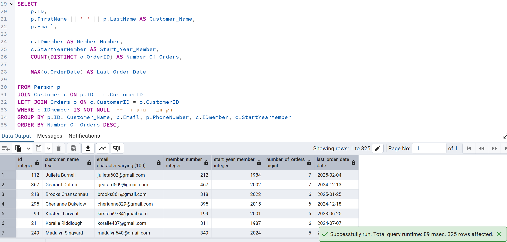

  

**11. Select Top Librarians** [View SQL](Part_Two/Queries/selectQueries/TheQueries_SQL/select_top_librarians.sql)
   
This query identifies the most productive librarians based on sales performance, aiding in staff evaluation and incentive programs.
   

  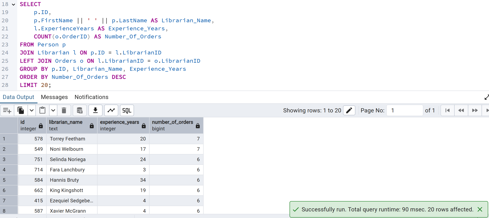

  

**12. Select Top Non-Members** [View SQL](Part_Two/Queries/selectQueries/TheQueries_SQL/select_top_non_members.sql)
   
This query identifies the most active club members based on order frequency in the past year, supporting targeted promotions and loyalty rewards for existing members.   

  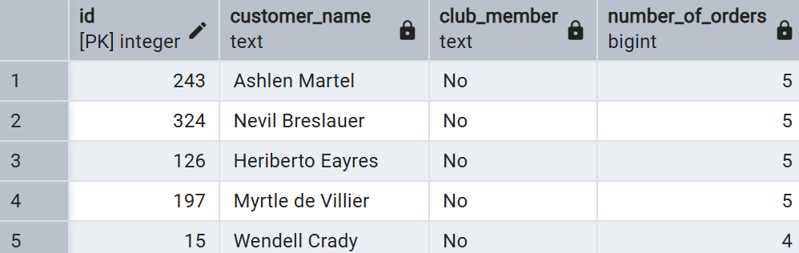

 

#### Query Execution Results in CSV Files

The following CSV files contain the results of executing the SELECT queries described above:

1. [Author Books Results](Part_Two/Queries/selectQueries/RunResults_CSV/select_author_books.csv) - Lists all books by specific authors
2. [Books by Age Group Results](Part_Two/Queries/selectQueries/RunResults_CSV/select_books_by_age_group.csv) - Shows books categorized by recommended age groups
3. [Books by Genre Results](Part_Two/Queries/selectQueries/RunResults_CSV/select_books_by_genre.csv) - Presents books organized by literary genres
4. [Books by Language Results](Part_Two/Queries/selectQueries/RunResults_CSV/select_books_by_language.csv) - Displays books available in various languages
5. [Books by Location Results](Part_Two/Queries/selectQueries/RunResults_CSV/select_books_by_location.csv) - Shows books organized by their physical location in the store
6. [Customer Order History Results](Part_Two/Queries/selectQueries/RunResults_CSV/select_customer_order_history.csv) - Contains detailed purchase history for individual customers
7. [Low Stock Books Results](Part_Two/Queries/selectQueries/RunResults_CSV/select_low_stock_books.csv) - Lists books with inventory levels below the threshold
8. [Monthly Sales Statistics Results](Part_Two/Queries/selectQueries/RunResults_CSV/select_monthly_sales_stats.csv) - Presents sales data aggregated by month
9. [Popular Books Results](Part_Two/Queries/selectQueries/RunResults_CSV/select_popular_books.csv) - Shows the most frequently purchased books
10. [Top Club Members Results](Part_Two/Queries/selectQueries/RunResults_CSV/select_top_club_members.csv) - Lists the most active members based on purchase volume
11. [Top Librarians Results](Part_Two/Queries/selectQueries/RunResults_CSV/select_top_librarians.csv) - Presents the highest-performing staff members
12. [Top Non-Members Results](Part_Two/Queries/selectQueries/RunResults_CSV/select_top_non_members.csv) - Identifies frequent customers who are not yet members

### Delete Queries

This section demonstrates DELETE operations that maintain database cleanliness by removing obsolete or unnecessary data.

**1. Delete Book Language Links** [View SQL](Part_Two/Queries/deleteQueries/delete_book_language_links.sql)
   
   This query removes language associations for books that are no longer in stock, maintaining referential integrity in the database.
   
   **During Execution:**
   

     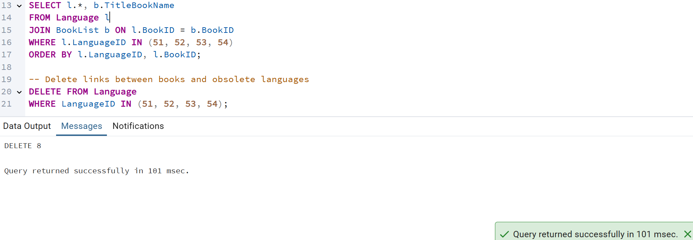
   

   
  **Before and After Execution:**
  

     

       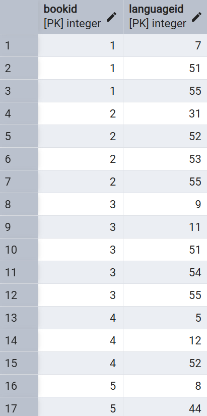
       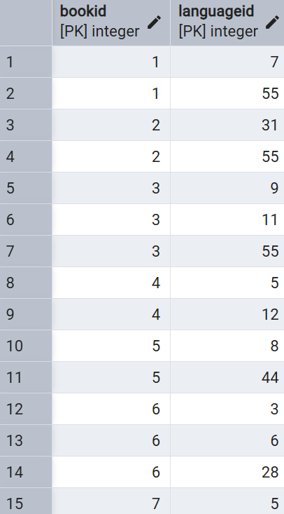
     

  
  
  

**2. Delete Obsolete Languages** [View SQL](Part_Two/Queries/deleteQueries/delete_obsolete_languages.sql)
   
   This query removes language records that are no longer associated with any books, streamlining the database.
   
   **During Execution:**
   

     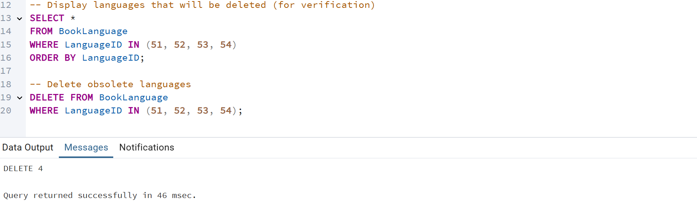
   

   
   
   **Before and After Execution:**
   

     

       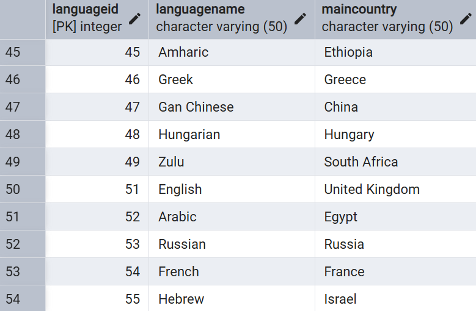
       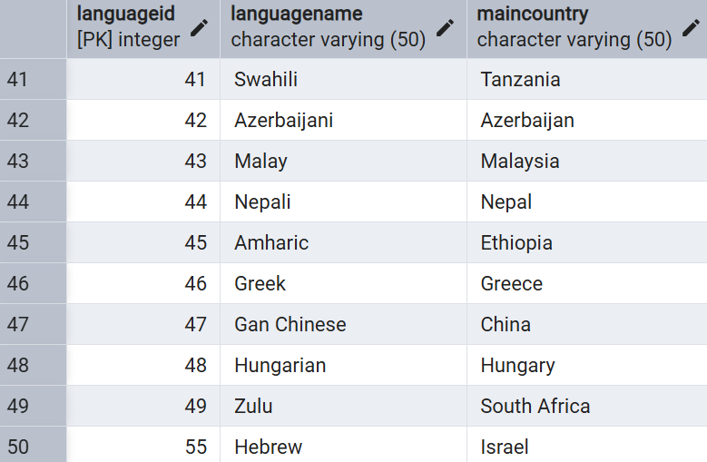
     

  
  

**3. Delete Unused Books** [View SQL](Part_Two/Queries/deleteQueries/delete_unused_books.sql)
   
   This query removes book records that have zero inventory and no recent sales, cleaning up the database.
   
   **During Execution:**
   

     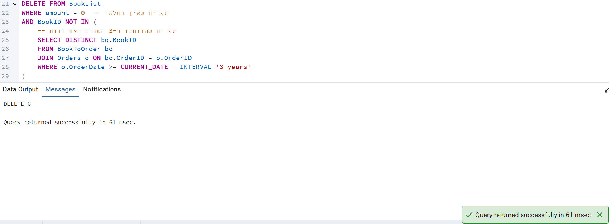
   

   
   **Before and After Execution:**
    

     

       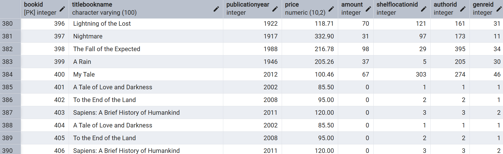
       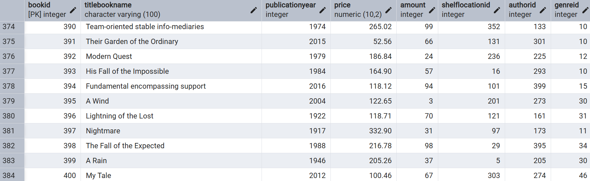
     

 
 

### Update Queries

This section demonstrates UPDATE operations that modify existing data to reflect changes in business conditions or correct information.

**1. Update Book Prices** [View SQL](Part_Two/Queries/updateQueries/update_book_prices.sql)
   
   This query adjusts book prices based on popularity and inventory levels, implementing dynamic pricing strategies.
   
   **During Execution:**
   

     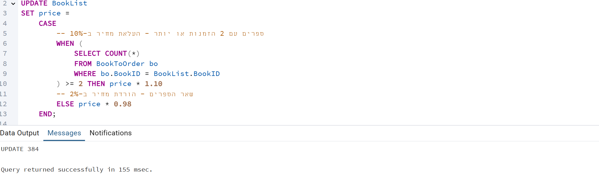
   

   
   **Before and After Execution:**
    

     

       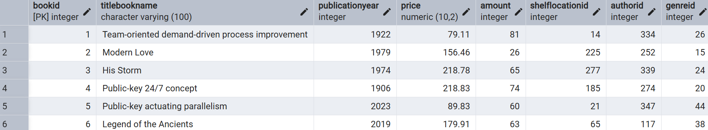
       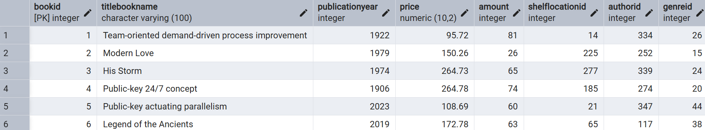
     

     
 

**2. Update Customer Discounts** [View SQL](Part_Two/Queries/updateQueries/update_customer_discounts.sql)
   
   This query updates customer discount rates based on purchase history and membership status, rewarding loyal customers.
   
   **During Execution:**
   

     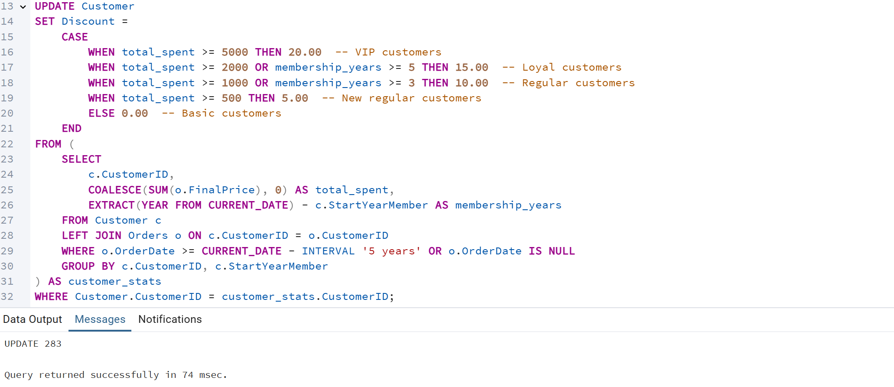
   

   
   **Before and After Execution:**
    

     

       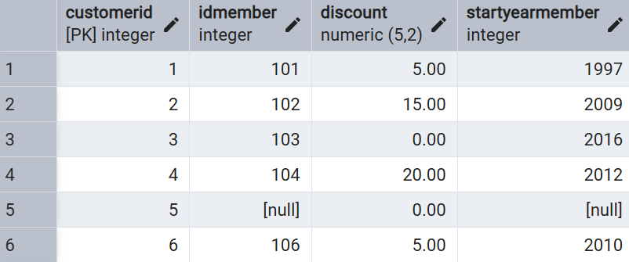
       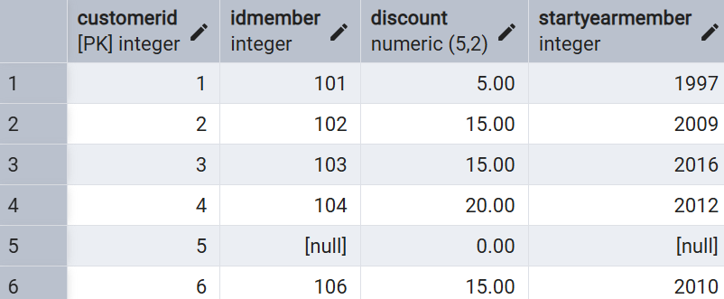
     

     
 

**3. Update Librarian Salaries** [View SQL](Part_Two/Queries/updateQueries/update_librarian_salaries.sql)
   
   This query adjusts librarian salaries based on performance metrics and experience, supporting fair compensation practices.
   
   **During Execution:**
   

     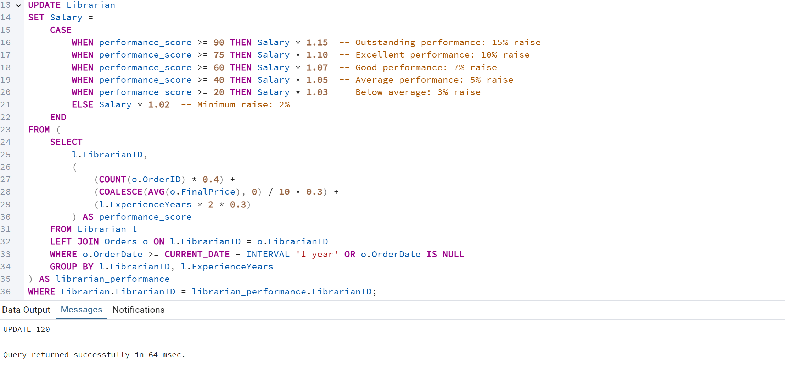
   

   
   **Before and After Execution:**
    

     

       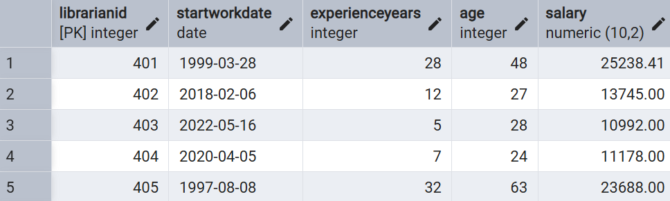
       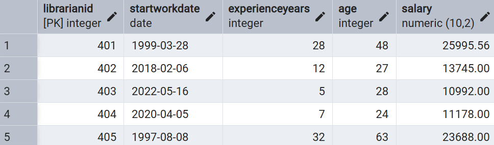
     

     

     
### Constraints

This section demonstrates the implementation of database constraints that enforce data integrity rules, ensuring the reliability and consistency of the stored information. [View Constraints SQL](Part_Two/Constraints.sql)

**1. Author First Name Not Null**
   
This constraint ensures that every author record includes a first name, maintaining complete author information.
   

  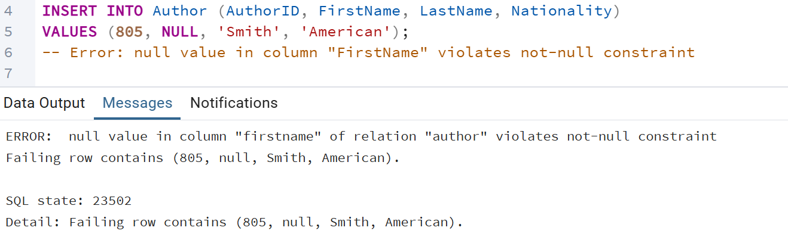

**2. Author Last Name Not Null**
   
This constraint ensures that every author record includes a last name, maintaining complete author information.
   

  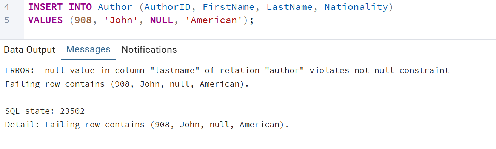

**3. Book Amount Positive**
   
This constraint ensures that book quantities in orders are always positive numbers, preventing invalid order entries.
   

  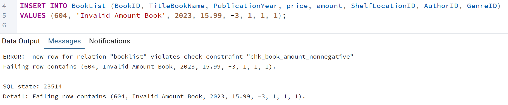

**4. Book Price Positive**
   
This constraint ensures that book prices are always positive values, preventing pricing errors.
   

  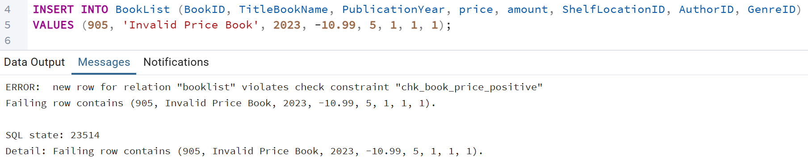

**5. Book Quantity Positive**
   
This constraint ensures that book inventory quantities are always positive numbers, maintaining accurate stock levels.
   

  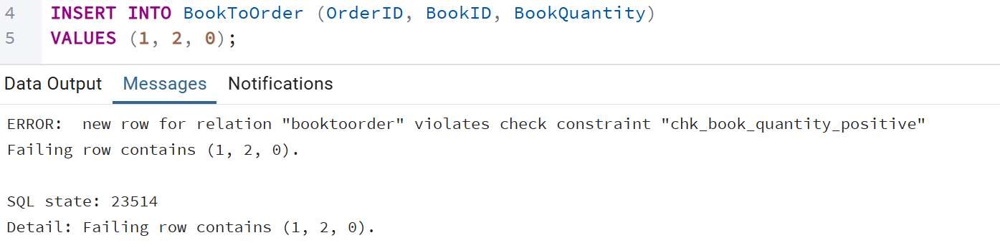

**6. Floor Positive**
   
This constraint ensures that shelf location floor numbers are always positive, maintaining valid location data.
   

  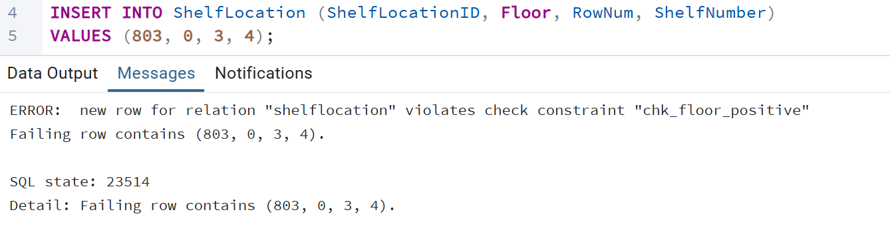

**7. Member ID Unique**
   
This constraint ensures that each customer has a unique membership ID, preventing duplicate memberships.
   

  

**8. Row Positive**
   
This constraint ensures that shelf row numbers are always positive, maintaining valid location data.
   

  

**9. Shelf Positive**
   
This constraint ensures that shelf numbers are always positive, maintaining valid location data.
   

  

 

### Rollback and Commit

This section demonstrates transaction management using ROLLBACK and COMMIT operations, which are essential for maintaining database consistency during complex operations. [View Rollback and Commit SQL](Part_Two/RollbackCommit.sql)

To perform the rollback and commit tests, I wanted to change the database for testing purposes. I wanted to create some books in the database with a quantity of 0, meaning books that were out of stock, and then restore the database to its original state - meaning a database containing only books that were in stock.

**Starting a Transaction And Some Changes**
   
To do this, first of all, I made sure that the entire database indeed contained an amount greater than zero. To do this, I ran a query that would change the quantity by selecting a random integer number:
   

  

 
**Saving Changes Using Commit**
   
After we saw in the run that the entire database indeed contained an amount greater than zero, we will commit the changes. That is, now the changes are saved and no book is out of stock:
   

  

 
**Starting a second transaction to make changes a second time**
   
In the next step, we will want to insert books with zero stock into the database for testing purposes. We will run to verify and see that some such books have indeed been inserted:
   

  

 
**Rollback Operation**
   
After we have performed the tests, we will want to return the database to its previous state, so that there will be no books with zero stock, so we will perform a rollback:
   

  

  

 
You can see that the entire list is back to normal, with a database containing only books that are in stock as in the state we started in.

As demonstrated, the ROLLBACK command effectively undoes all changes made during the transaction, returning our database to its original consistent state with no out-of-stock books. This powerful feature allows for safe testing and protects against data corruption by ensuring operations are either fully completed or completely reversed, maintaining the integrity and reliability of our bookstore database system.
### Backup Part-Two

To ensure data safety and provide disaster recovery capabilities, a comprehensive backup of the database was created after completing all operations in Part Two.

**Data Backup File** [View Backup File](Part_Two/Backup/backup_2025_05_11.backup)

This backup contains the complete database state, including all tables, constraints, and data as of May 11, 2025. It can be used to restore the database to this point in time if needed.

## Part Three: Integration and Views

The original system was designed to manage a bookstore, including inventory tracking, order and payment records, and management of sellers and customers. The focus was exclusively on selling books to individual customers.

At this stage, I received a backup of a separate library system and was required to integrate both systems into one unified and logical solution.  
I began by considering how to conceptually combine the library system with the bookstore. The chosen approach was to treat the bookstore as a supplier of books to the library, while still serving private customers.

The library, on the other hand, manages its own borrowing system, but can request books from the bookstore as new reader demands arise.  
This results in a hybrid system where the bookstore continues selling to private customers but also acts as an official supplier to the library—enabling partial, coordinated data sharing between the two domains.

### Library Department ERD & DSD

The system describes a digital library including representations of books, copies, readers, librarians, and authors, along with operations such as borrowing, ordering, and fines. The data is connected through logical relationships enabling comprehensive and accurate tracking of library activities and daily management.

#### ERD (Entity-Relationship Diagram)  

#### DSD (Data Structure Diagram)  

### Post-Integration ERD & DSD

The integrated system, after merging the library system with the bookstore, has been designed and planned following numerous changes and endless discussions on the diagrams above:

#### ERD (Entity-Relationship Diagram)  

#### DSD (Data Structure Diagram)  

### Integration Process and Decisions

The creation of the final database was carried out through a step-by-step renovation and correction of my existing bookstore database. The workflow was divided into two main stages:

First, I prepared the bookstore database to optimally import the backup data from the library system. This involved careful handling of identical tables to ensure that the values from both the existing data and the backup would be properly merged. This process included creating new columns, renaming tables, and creating empty tables to receive data from the new backup.

Only after successfully completing the backup import—with all data placed in the correct locations, was I able to upgrade and refine the system to the precise logical design I had planned.

First, I will attach the two relevant files through which I modified the single database into the integrated database.
These two files are like the required Integrate.sql file in the assignment, but split into two separate files for convenience.  

**Phase One: Prepare Database [View Prepare DB Script](./Part_Three/Integrate/prepare-database-import.sql)**  
**Phase Two: Complete Migration [View Complete Migration Script](./Part_Three/Integrate/complete-database-migration.sql)**

#### Phase One – Preparing the Database for Backup Import

To enable the import of the library system backup, I made adjustments to the bookstore database to fit the new data structure. The process included three main parts:

**1. Structural Preparation**

- ENUM types matching the library’s values were defined, table and column names were changed for full compatibility, and new columns were added to existing tables to handle additional information. Every change was done while checking to prevent duplicates and allow repeated script execution.

- Existing tables were backed up before structural changes to allow recovery if needed. Foreign key relationships were updated to the new names while maintaining referential integrity between entities.

- New empty tables representing entities that exist only in the library system were created to enable direct import of the backup data.

**2. Data Restoration After Import**

- After importing the backup, missing fields were restored based on existing keys. Validation commands were added to verify data integrity and detect issues early.

**3. Cleanup of Backup Tables**

- After verification and approval of system stability, deliberate cleanup of backup tables was performed to maintain a clean and organized database containing only active tables.

Throughout these stages, the bookstore database was fully adapted to safely and reliably support the import of library data.  
At this stage, the connection between the two systems was mainly technical — meaning first I wanted to create a database containing all data from the second system with all common tables and import also those that weren’t common, and only afterward begin the necessary fixes and changes to ensure the whole system works correctly also logically.

#### Phase Two – Post-Import Adjustments and Optimization

After data import, important changes were made to align the integrated system with the combined design. The commands and fixes executed at this stage aimed to unify the library and bookstore systems more from the logical perspective — ensuring all table relationships are correct, and the entire system operates in a logical and coherent collaboration as one complete and perfect system.

The optimizations included saving storage space, preventing duplication, and maintaining data consistency by updating table structures and their relationships through targeted SQL commands.

The final result from running these two scripts is a clean, normalized database supporting the combined activity of library and bookstore, with proper inheritance, referential integrity, and scalability for future expansion.

#### Conflicts and Dilemmas Encountered During the Work:

During the integration phase between the **bookstore system** and the **library system**, I encountered several **key challenges** that required **significant decisions** regarding the database structure.

First, I realized that the **table names and structures** in the two systems did **not match** each other, so **adjustments and renaming** were necessary to **prevent conflicts** when merging the data. For example, the **`Librarian`** table was renamed to **`Seller`** to accurately reflect the role of users in the integrated system, and the corresponding column in the **`Orders`** table was also renamed accordingly. Additionally, in the library system, some tables had **missing or different columns**, so I added the **necessary columns** to existing tables to allow **full preservation** of all backup data, while carefully checking for the existence of columns to avoid issues when running scripts repeatedly.

Furthermore, **new tables missing** from the bookstore system were added, such as **`Reader`**, **`Borrow`**, and **`Fine`**, which are essential for managing loans and fines in the library. This created a **new layer** that integrates library operations within the expanded system. At the same time, I **consolidated existing tables** with similar content, successfully **reducing duplication** and **improving the underlying logic** of the data — for example, unifying the link tables between books and authors and genres.

The process also presented **logical challenges**, such as the need to **separate different roles** of people in the system (**readers, sellers, librarians, authors**). Therefore, I created a **hierarchy of tables** based on a single **`Person`** parent table, from which specialized tables inherit. This decision significantly improved **data management** and **consistency**, as well as facilitating **future system extensions**.

In summary, the new system created is a **hybrid and integrated system** that efficiently combines the **commercial activity** of the bookstore with **library management**, maintaining **data integrity** and **flexibility** for various purposes, all while solving **complex design problems** that arose during the integration process.

### Views  
#### View 1: On Bookstore Orders `CustomerOrderDetails`

You can view the SQL code that defines this view here: [Book Store View SQL](./Part_Three/Views/bookStoreView.sql)  
CSV file showing the **first ten rows** of the view output: [Book Store View Data CSV](./Part_Three/Views/viewDataCSV/bookStoreViewData.csv)

This view consolidates detailed order information from the **original department's perspective** (the bookstore).  
It combines data about orders, customers, books, authors, genres, and the librarians involved in the order process.

- Displays order ID, date, final price, customer name and email, membership discount and start year.  
- Shows book details including title, author, genre, quantity ordered, price per book, and total price for the quantity.  
- Includes librarian’s name responsible for the order (if assigned).  
- Uses multiple JOINs to gather related information across tables.  
- A LEFT JOIN is used for librarian data to ensure orders without assigned librarians still appear.  
- Calculates the total book price per order item to assist revenue analysis.

This view supports rich queries to analyze sales, customer behavior, and order fulfillment.

#### View 2: On Library Borrowings  `BorrowingAndFinesDetails`

You can view the SQL code that defines this view here: [Library View SQL](./Part_Three/Views/libraryView.sql)  
CSV file showing the **first ten rows** of the view output: [Library View Data CSV](./Part_Three/Views/viewDataCSV/libraryViewData.csv)

This view presents detailed information about borrowing transactions and fines from the **receiving department's perspective** (the library).

- Shows borrowing records including borrow number, reader's name, phone, birth date, and membership start date.  
- Includes borrowing and return dates, plus a calculated status: 'Overdue', 'Returned', or 'Active'.  
- Lists related fines with reason, amount, payment status, and fine date.  
- Provides librarian contact info overseeing the borrowing and fine management.  
- Uses JOINs to combine data from Borrow, Reader, Person, Librarian, and Fine tables.  
- Uses a LEFT JOIN on fines to include borrowings without fines.

The view simplifies tracking and management of loans and fines, improving oversight and communication.

### Queries

#### Queries for the Bookstore View `CustomerOrderDetails`

You can view the full SQL script containing all bookstore-related queries here: [View Bookstore Queries SQL](./Part_Three/Queries/bookStoreQueries.sql)  
CSV file showing the **query result** for the top-spending customers: [First Query Bookstore Data CSV](./Part_Three/Queries/viewDataCSV/firstQuerieBookStore.csv)  
CSV file showing the **query result** for the top 20 bestsellers: [Second Query Bookstore Data CSV](./Part_Three/Queries/viewDataCSV/secondQuerieBookStore.csv) 

**1. Most Active Customers**  
Display customers who spent more than 500 in the past year.

   - Filters only orders from the past year.  
   - Groups results by customer name and email.  
   - Counts the number of orders each customer placed (`COUNT(DISTINCT OrderID)`).  
   - Calculates total amount spent by each customer (`SUM(FinalPrice)`).  
   - Includes only customers who spent more than 500.  
   - Sorts the output by total spending in descending order.  

The result shows a detailed list of customers who were most engaged in purchasing over the past year. For each customer, it includes their name and contact email, the total number of distinct orders they placed, their cumulative spending above 500, and the year they began their membership. This helps identify loyal and high-value customers, enabling targeted marketing or rewards strategies. 

**2. Top 20 Best-Selling Books**  
Display the 20 best-selling books in the last year.
 
   - Filters orders placed within the past year.  
   - Groups by book title, author name, and genre name.  
   - Sums the total quantity sold for each book (`SUM(BookQuantity)`).  
   - Calculates total revenue per book (`SUM(TotalBookPrice)`).  
   - Returns the top 20 books with the highest sales (`ORDER BY TotalSold DESC LIMIT 20`).  

This query highlights the most popular books in the store over the past year by aggregating sales data. It shows each book’s title, author, genre, total quantity sold, and the total revenue generated. This insight is valuable for inventory management, promotional planning, and understanding customer preferences.  

#### Queries for the Library View `BorrowingAndFinesDetails`  

You can view the full SQL script containing all library-related queries here: [View Library Queries SQL](./Part_Three/Queries/libraryQueries.sql)  
CSV file showing the **query result** for overdue readers and unpaid fines: [First Query Library Data CSV](./Part_Three/Queries/viewDataCSV/firstQuerieLibrary.csv)  
CSV file showing the **query result** for borrowing patterns by age group: [Second Query Library Data CSV](./Part_Three/Queries/viewDataCSV/secondQuerieLibrary.csv)  

**1. Overdue Readers and Unpaid Fines**  
Display readers who have overdue books or unpaid fines.

   - Combines borrow and fine records from the library system.  
   - Groups by reader to count how many books are overdue and how many fines are unpaid.  
   - Sums the total amount owed.  
   - Calculates how long each reader has been active in the system.  
   - Filters based on borrowing status and fine payment status.  

The output provides detailed information about each reader with outstanding issues: their name and phone number, how many books are currently overdue, the number of unpaid fines, the total amount owed, and the duration of their membership based on their first borrowing date. This overview helps library staff prioritize follow-ups and understand reader behavior regarding returns and fines.   

**2. Borrowing Patterns by Age Group**  
Analyze how different age groups borrow books over the past year.

   - Groups all borrow records by reader age group.  
   - Counts total number of readers and borrows per group.  
   - Calculates the average duration of borrowing (`AVG(return_date - borrow_date)`).  
   - Counts how many of those borrows were overdue.  
   - Helps identify trends by age demographic.  

This analysis highlights borrowing behaviors across different demographics by showing the size of each age group in terms of readers and borrowing activity, the average time books are kept, and the frequency of overdue returns. These insights support library management in tailoring services and outreach efforts to each age group’s needs and habits. 

### Backup Part-Three

After successfully integrating and unifying the bookstore and library systems into a single, cohesive database, a comprehensive backup was created to ensure data safety and provide disaster recovery capabilities.

This backup includes the entire state of the combined system, capturing all merged and synchronized data from both the original library and bookstore systems after integration.

**Data Backup File** [View Backup File](./Part_Three/Backup/backup3.backup)

This backup contains all tables, constraints, and integrated data reflecting the unified system, ready for restoration if needed.
